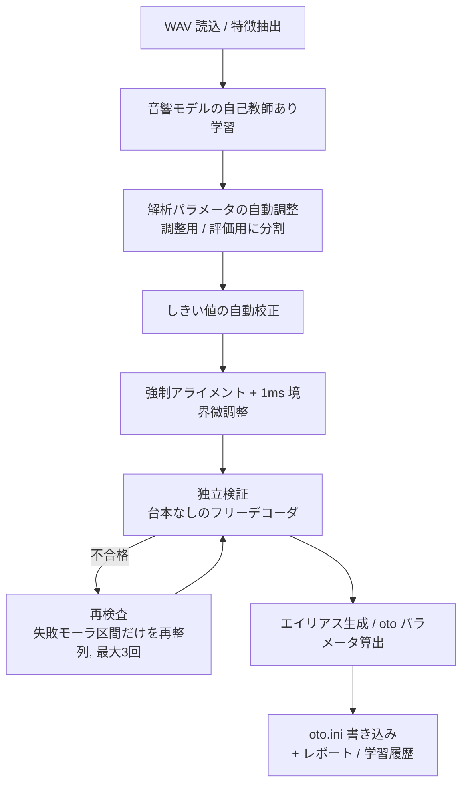

# otoium

UTAU 用の `oto.ini` を WAV から自動生成するツールです。単独音(CV)・連続音(VCV)・CVVC に対応します。
音声認識モデルは使わず、音素アライメントを中心にした専用の解析エンジンで境界を推定します。
依存ライブラリは `numpy` と `scipy` のみです（`soundfile` は任意）。

> **注意** 合成音声による自動テストのみで検証しています。実録音での精度は未検証です（[既知の制限](#既知の制限)）。
> 出力は必ず UTAU / OpenUtau 上で確認してください。

## 特徴

- 1 つの WAV から複数のエイリアスを生成（例: `_あかさたな.wav` → `あ` / `あ か` / `か さ` / `さ た` / `た な`）
- ファイル名や台本は「仮説」として使い、別系統の独立認識で検証。不一致は `oto.ini` に入れない
- 自己教師あり学習（ガウスモデル + numpy 製 MLP のアンサンブル）で話者・マイク・部屋に適応
- 解析パラメータ・しきい値の自動調整と自動校正
- 失敗した箇所だけをやり直す再検査（最大 3 回）。失敗しても `oto.ini` へ強制書き込みも可能
- tkinter GUI（学習曲線、波形と音素境界の表示、再検査、エイリアス単位の出力切替）
- かな（ひらがな・カタカナ）、ローマ字、`ヴ` や外来音、小書き文字に対応

## インストール

Python 3.9 以上。

```bash
git clone <this-repository>
cd otoium_app
pip install -r requirements.txt
```

GUI は標準ライブラリの `tkinter` を使います（Linux では `python3-tk` が別途必要な場合があります）。

## クイックスタート

```bash
# WAV のあるフォルダを指定 (サブフォルダも処理)。モードは自動 (1 モーラ=CV / 複数=VCV)
python run_otoium.py ./my_voicebank

# 連続音 (VCV)、最高精度
python run_otoium.py ./my_voicebank --mode vcv --accuracy max

# 引数なしで GUI
python run_otoium.py
```

ファイル名がそのまま台本になります（先頭の `_` や拡張子は無視）。台本は 8mora 形式
(`scripts/8mora.txt`) を想定していますが、ほかの台本でも、ファイル名または `--script` で渡したテキストを使います。

## 台本ファイル

`--script` に、1 行 1 ファイルのテキストを渡せます。区切りは `=`、タブ、空白のいずれかです。`#` で始まる行はコメントです。

```
_あんああいあうあ.wav=あんああいあうあ
sample01  ka sa ta na
```

対応する表記:

| 種類 | 例 |
|---|---|
| ひらがな・カタカナ | `か` `ガ` `きゃ` `てぃ` `ふぁ` `うぃ` `つぁ` `くぁ` `ヴぃ` `ゎ` `ヵ` |
| ローマ字 | `ka` `kya` `shi` `si` `ti` `tu` `hu` `sya` `tya` `kka`(促音) `va` `n'` |
| 無視される記号 | `_` 空白 `-` `・` `ー` `っ` 数字 など |

未対応の文字が含まれるファイルは失敗として扱います。`--skip-unknown`（GUI は「未対応文字を無視して解析」）を付けると、
その文字だけを無視して解析し、無視した文字をレポートに記録します。

## 主なオプション

| オプション | 内容 |
|---|---|
| `--mode auto\|cv\|vcv\|cvvc` | 出力形式。既定 `auto` |
| `--vcv-style mora\|vowel` | VCV の前置き表記。`mora`: `か さ` / `vowel`: `あ さ` |
| `--vc-style romaji\|kana` | CVVC の VC 表記（`a k` / `あ k`） |
| `--head-prefix`, `--prefix`, `--suffix`, `--tail` | 先頭エイリアスの接頭辞、全体の接頭辞・接尾辞、末尾 `V -` の生成 |
| `--encoding cp932\|utf-8` | `oto.ini` の文字コード。既定 `cp932` |
| `--script FILE` | 台本ファイル |
| `--accuracy fast\|high\|max\|ultra\|custom` | 精度プリセット（下表） |
| `--iters` `--tune-rounds` `--net-epochs` `--net-ensemble` `--adapt-rounds` `--post-iters` `--confident-rounds` | 各回数を個別に指定 |
| `--patience N` `--converge-shift X` | 収束判定（`--patience 0` で早期終了なし） |
| `--recheck-rounds N` | 失敗箇所の再検査の最大回数（既定 3、0 で無効） |
| `--no-partial-repair` | 失敗モーラ区間だけのやり直しを無効化 |
| `--write-failed` | 失敗・保留も `oto.ini` に書き込む（一覧は `otoium_forced.txt`） |
| `--strict` | WARN も `oto.ini` から除外 |
| `--no-net` `--no-adapt` `--no-tune` `--no-rescue` `--no-refine` `--no-auto-thresholds` | 各処理を個別に無効化 |
| `--model FILE` | 学習済みモデル（`.npz`）を読み込む（学習をスキップ） |
| `--merge` | 既存 `oto.ini` のうち、今回処理しないファイルの行を残す |
| `--jobs N` | 特徴抽出の並列数 |
| `--labels` `--textgrid` | Audacity ラベル / Praat TextGrid を出力 |
| `--dry-run` `--no-backup` `--no-recursive` `--no-dedupe` `--no-cache` | 書き込まない / バックアップしない / サブフォルダを処理しない / 重複整理しない / キャッシュを使わない |

終了コード: `0` 正常 / `2` 失敗ファイルあり / `1` 実行エラー。

### 精度モード

| モード | ガウス学習 | 自動調整 | NN (エポック×数) | 適応 | 再学習 | 高信頼再学習 | 収束の我慢回数 |
|---|---|---|---|---|---|---|---|
| fast | 3 | なし | なし | なし | 0 | 0 | 1 |
| high（既定） | 5 | 1 周 | 10×1 | 1 | 2 | 0 | 2 |
| max | 8 | 2 周 | 14×2 | 2 | 3 | 1 | 3 |
| ultra | 12 | 3 周（細かい探索） | 20×3 | 3 | 4 | 2 | 0 |
| custom | `--iters` | `--tune-rounds` | `--net-epochs` `--net-ensemble` | `--adapt-rounds` | `--post-iters` | `--confident-rounds` | `--patience` |

`custom` 以外でも、個別指定はプリセットの値を上書きします（例: `--accuracy max --net-ensemble 4`）。
学習は「境界がほぼ動かない」かつ「検証スコアが伸びない」が連続し、予定回数の半分を回した後にだけ終了します。

## 処理の流れ



1. **特徴抽出** (`features.py`): 有声度・ZCR・高域/低域比・重心・F1/F2 近似・MFCC・Δ・境界証拠・1ms 包絡。DC 除去とノイズフロア正規化を行う。
2. **音素ユニット** (`phoneset.py`, `kana.py`): 破裂音は「閉鎖 + 破裂」、破擦音は「閉鎖 + 摩擦」、拗音は「+ 半母音」に分解する。
3. **音響モデル** (`model.py`, `mlp.py`): クラス事前分布から始め、Viterbi 再推定で適応する。numpy 製 MLP をアンサンブルで併用する。音素ごとの時間長分布も学習する。
4. **アライメント** (`aligner.py`, `refine.py`): 時間長制約付きセミマルコフ Viterbi と境界証拠ボーナス。
5. **独立検証** (`verify.py`): 台本を使わずにフレームを認識し、母音一致率・子音の確認・境界確信度・母音核の数で照合する。
6. **自動調整・校正** (`tune.py`, `calibrate.py`): 整列側のパラメータだけを調整する（検証側は自己採点になるため対象外）。
7. **エイリアス生成** (`aliases.py`, `oto.py`): Offset / Consonant / Cutoff / Preutterance / Overlap を境界から算出する。

## 状態の意味

| 状態 | 意味 | `oto.ini` |
|---|---|---|
| OK | 検証に合格 | 出力 |
| WARN | 境界が弱い・無声化母音の可能性など | 出力（`--strict` で除外） |
| REVIEW | 検証に不合格（確信度不足） | 出力しない（`oto_review.txt` に記録。`--write-failed` で出力） |
| ERROR / FAIL | 母音不一致・分割失敗など | 出力しない（`--write-failed` で出力） |

不合格の判定は次を満たしたときに出ます: 母音の独立認識の不一致、子音が音響的に確認できない、境界が不明瞭、
独立に数えた母音核の数が期待と大きく違う、モーラの 4 割以上が不合格。「ん」だけで構成されるファイル（`_んん` など）は鼻音の核で判定し、
「ん」同士の境界は音響的に特定できないため推定位置として扱います。

## 失敗したときの動作

- **再検査**: 一通り終わった後、失敗したモーラの連続区間だけを、前後の良いモーラを固定したまま再整列します（最大 3 回）。
  整列自体が得られないファイルは 2 回目以降にファイル全体を再解析します。3 回でも不合格なら終了し、理由をレポートに残します。
- **強制出力**: `--write-failed` を付けると不合格分も書き込みます。書き込んだ分は `otoium_forced.txt` に理由つきで一覧されます。
  使用区間が録音長を超えるなど、数値として成立しないエントリは書きません。
- **GUI**: 結果タブから、実行後に「選択を再検査」「不合格をすべて再検査」「oto.ini に書き込む」ができます。
  エイリアス行のダブルクリックで、そのエイリアスを書く/書かないを個別に切り替えられます（手動で「書く」にしたものは重複整理でも優先）。

## 出力ファイル

| ファイル | 内容 |
|---|---|
| `oto.ini` | 各フォルダに出力。既存は初回書き込み時に `oto.ini.bak` へ退避。出力が 0 件のときは既存ファイルを変更しない。一時ファイル経由で置換 |
| `oto_review.txt` | 確信度不足・不合格で入れなかった候補と理由 |
| `otoium_forced.txt` | `--write-failed` で強制的に書き込んだエントリと理由 |
| `otoium_report.json` / `.txt` | ファイルごと・モーラごとの検証結果、エイリアスごとの確信度 |
| `otoium_training.csv` / `.json` | 学習の得点の履歴（検証スコア、尤度、境界の変化、NN 損失・精度） |
| `otoium_model.npz` | 学習済みモデル（`--model` で再利用） |
| `.otoium_cache/` | 特徴量キャッシュ（npz） |

## GUI

引数なしで起動します。「設定」「学習」「結果」「ログ」の 4 タブです。

- **学習**: 検証スコア・平均対数尤度・境界の変化・NN 損失・NN 精度・自動調整スコアの曲線をリアルタイム表示。
  得点が最高だったモデルを保持し、学習終了時に悪化していれば戻します（NN 構成が同じものに限る）。
- **結果**: 波形・音素区間・モーラの状態を表示。ホイールで拡大縮小、ドラッグで移動。エイリアスを選ぶと oto の各位置を波形に表示。
- 設定の保存・読込、実行中の中止、カスタム精度の回数指定に対応。

## 安全性

- 特徴量キャッシュは npz で、`pickle` を使いません（`allow_pickle=False`）。壊れた・改ざんされたキャッシュは捨てて再計算します。
- 時間情報は、有限・録音長内・単調増加・モーラ間で重ならないことを検査します。不整合は失敗として扱います。
- 自動調整は調整用ファイルと評価用ファイルを分け、評価用で悪化したら調整結果を採用しません。
- 救済や自動調整が検証側のパラメータを動かすことはありません。録音ごとの適応モデルは整列にだけ使い、検証は適応前のモデルで行います。

## テスト

```bash
python -m unittest tests.test_otoium -v
```

フォルマント合成器（`tests/synth.py`）で、正解の境界つきの連続音を作って検証します。
ノイズ・残響・音素の重なり・発話速度・声の高さ・DC オフセットなどの条件を含みます。
全件で数分かかります。

## ディレクトリ構成

```
otoium_app/
├── run_otoium.py        # エントリポイント (引数なしで GUI)
├── requirements.txt
├── scripts/8mora.txt    # 8mora 録音台本 (サンプル)
├── docs/DESIGN.md       # 設計メモ
├── otoium/
│   ├── cli.py  gui.py  config.py  pipeline.py
│   ├── audio_io.py  features.py  phoneset.py  kana.py
│   ├── model.py  mlp.py  aligner.py  refine.py
│   ├── verify.py  evaluate.py  tune.py  calibrate.py
│   ├── aliases.py  oto.py  export.py  metrics.py
└── tests/               # test_otoium.py, synth.py
```

## 既知の制限

- 実録音での精度は未検証です。F1/F2 の近似特徴、1ms 微調整、しきい値の自動校正は、実録音と手動で設定した正解の `oto.ini` による比較評価が必要です。
- 自己教師あり学習は、整列結果を教師にします。外れファイルの除外・信頼度の重み付け・高信頼ファイルでの再学習で軽減していますが、誤整列の蓄積を完全には防げません。
- 子音の確認は、台本なしのフレーム認識との照合で、粗い判定です。似た子音どうし（`s` と `sh` など）の取り違えは検出できません。
- 無声化母音は、直前が無声子音で有声度が低い場合に WARN として扱います。実録音での挙動は未検証です。
- 先頭モーラの破裂音は、閉鎖が無音と区別できないため、子音の開始位置は推定になります。
- 「ん」の連続や鼻音どうしの境界は、音響的に曖昧です。

## ライセンス

未設定です。公開時に `LICENSE` を追加してください。
